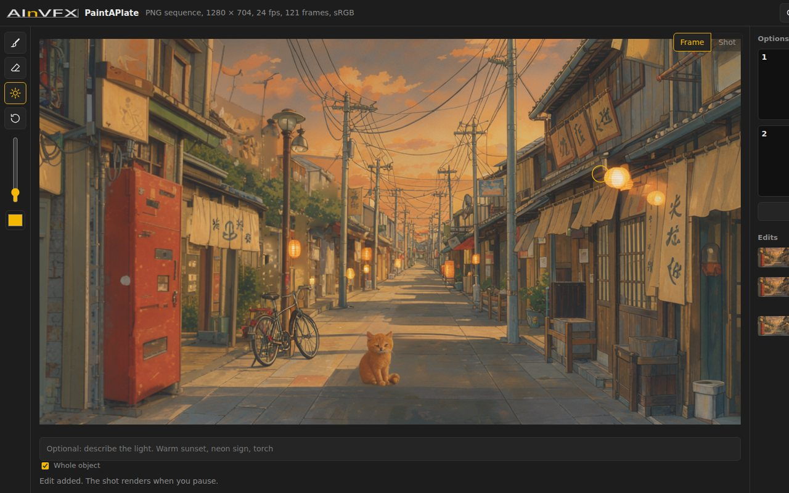

# AInVFX PaintAPlate

[](https://github.com/AInVFX/ainvfx-paintaplate/actions/workflows/tests.yml)

Paint on the first frame of a shot to erase, add or relight. Two options appear while you paint. Pick one, and the whole shot comes back in the plate's own format: same file type, bit depth, frame numbers, colour space, layers, timecode and audio. Pixels you did not touch stay identical to the input.



PaintAPlate runs inside ComfyUI. The app is one page served by ComfyUI, and every step is an ordinary workflow you can open, read and change. Built for Comfy's Open Source Higgsfield challenge, October 2026.

## Install

1. ComfyUI 0.42.5 or newer. Tested on 0.42.5 and on the main branch of 24 October 2026 (`19ae172b`). ACEScg plates need a build after 0.42.5.
2. Install this pack from the Registry (ComfyUI-Manager, search "PaintAPlate"), or clone it into `ComfyUI/custom_nodes/` and run `pip install -r requirements.txt`.
3. Install **ComfyUI-LTXVideo** (Lightricks) for the LTX IC-LoRA guide node.
4. Download the models below, then restart ComfyUI.
5. Open the app from **Extensions > Open PaintAPlate**, or at `http://127.0.0.1:8188/extensions/ainvfx-paintaplate/paintaplate.html`.

Start ComfyUI with `--preview-method latent2rgb` for live previews. On a 96 GB card, add `--highvram` so the models stay loaded. If a model file is missing, the app names it when it opens.

## Models

| Folder | File | Source | Licence |
| --- | --- | --- | --- |
| `diffusion_models` | `flux3-image-klein-int8-convrot.safetensors` (5.8 GB) | `black-forest-labs/flux-3-image-klein-comfy` | FLUX Kommunity |
| `text_encoders` | `qwen3vl_4b_int8_convrot.safetensors` (4.9 GB) | same repo | FLUX Kommunity |
| `vae` | `flux2-vae.safetensors` | same repo, `vae/` | FLUX Kommunity |
| `diffusion_models` | `ltx-2.5-22b-distilled-transformer-comfy-int8-convrot.safetensors` (21.5 GB) | `Lightricks/LTX-2.5` | LTX-2 Community |
| `text_encoders` | `gemma4-12b-with-proj-ltx-2.5-comfy-int8-convrot.safetensors` (15.4 GB) | `Lightricks/LTX-2.5` | LTX-2 Community |
| `vae` | `ltx-2.5-video-vae-conv-bf16.safetensors`, `ltx-2.5-audio-vae-bf16.safetensors` | `Lightricks/LTX-2.5` | LTX-2 Community |
| `loras` | `LTX25_Ripple_v11.safetensors` | `WepeNerd/LTX-Ripple` | LTX-2 Community |
| `checkpoints` | `sam3.1_multiplex_fp16.safetensors` | `Comfy-Org/sam3.1` (the file of the official SAM 3 template) | SAM License |

All models are open weights. The FLUX, LTX and SAM repositories ask you to accept their licence on Hugging Face first. Everything fits in about 52 GB of VRAM, plus working memory for the shot.

## Use

| Tool | Key | What it does |
| --- | --- | --- |
| Paint | B | Paint a rough shape in a colour, then say what it is: "a fire", "a wooden desk" |
| Erase | E | Paint a stroke on what should go. With **Whole object** on (the default), SAM 3.1 grows the stroke to the object under it. Turn it off to erase only what you paint |
| Light | L | Paint where the light comes from, in its colour. Words are optional |
| Restore | R | Brings back the plate under the brush |

`[` and `]` change the brush size, `1` and `2` pick an option, `Enter` asks for two new ones, `Esc` discards the edit and `Ctrl+Z` undoes a stroke. Hold `O` to see the original frame. `?` shows all keys. Up to three edits stack on one shot.

When you pause, PaintAPlate works in the background. It renders the shot at half size so you can watch it soon, then at full size, tracks the edited areas and exports at full quality. A new stroke cancels that work and restarts from the cheapest step it affects.

## Speed

Measured on 25 October 2026 on an RTX PRO 6000 (96 GB), with plates of 121 frames at 1920 × 1012 and the models on a network volume:

| Step | Time |
| --- | --- |
| Open an EXR sequence / an H.264 video | 20 s / 4.5 s |
| First option after a stroke / both options | 0.7 s / 1.6 s |
| Pick an option (full-size refine) | 5 s, or 8 s for an erase that finds the object first |
| Shot at half size / full size | 37 to 52 s / 140 s |
| Track the edited areas (SAM 3.1) | 6 to 15 s per area |
| Export 121 EXR frames / one video | 16 to 52 s |

After a cold start, the first stroke and the first shot also wait for their models: about 16 s for FLUX 3 Image Klein and 80 s for LTX 2.5 from a network volume, less from a local disk.

## What you get back

- Outside the edited areas, EXR, PNG, TIFF and DPX output is identical to the input, bit for bit. A video output is re-encoded, so untouched pixels are as close as the codec allows.
- A relight changes every pixel by design. Its fine detail still comes from the plate.
- Shots up to 121 frames (5 s at 24 fps). Edits are painted on the first frame.
- Erase works best on whole, compact objects. A thin object such as a pole can come back: paint a wider stroke over it. With **Whole object** off, a stroke that covers only part of an object can make the model rebuild it.
- The Ripple model card says to replace the first frame, which is what this pack does. Its author's example workflow prepends it instead, which shifts the plate by one frame.

## How it works

| Workflow | Steps |
| --- | --- |
| `ingest` | Load Plate, Convert Image Color Space, first frame and a playback proxy |
| `edit` | FLUX 3 Image Klein edits inside the painted mask; Image Composite Masked keeps every other pixel |
| `shot` | LTX 2.5 with the Ripple IC-LoRA carries the edited first frame through the shot |
| `matte` | SAM 3.1 follows each painted area through the frames |
| `export` | Fit to Plate, Relight Transfer, Image Composite Masked, Save Plate |

Core ComfyUI does the colour conversion, compositing, masks, sampling and step previews. Four nodes fill the gaps:

| Node | Gap it fills |
| --- | --- |
| Load Plate | Folders of frames, the source spec, padding to the 8k+1 frames LTX needs. Decoding is core's |
| Save Plate | Writes in the source format. For EXR, every other layer, part and header attribute is kept, and pixels outside the edit are copied bit for bit. Video keeps codec, pixel format, colour tags, timecode and audio |
| Fit to Plate | Resizes generated frames to the plate, removes small shifts, matches colour and grain around the edit |
| Relight Transfer | Takes light, shadows and reflections from the regenerated shot and keeps the plate's own texture, grain, sharpness and highlights above 1.0 |

The page fills named slots in each workflow and posts it to ComfyUI. Step previews arrive over ComfyUI's WebSocket, so an option starts to appear after the first sampling step.

## Tests

```bash
pip install -r tests/requirements.txt
python -m unittest discover -s tests -v                            # no ComfyUI, no models, no GPU

bash tools/ci_comfyui.sh .ci                                       # a CPU ComfyUI at the tested commits, empty model files
COMFYUI_DIR=$PWD/.ci/ComfyUI python -m unittest discover -s tests -v   # adds a real ComfyUI and a headless browser
```

The suite checks the plate I/O, the maths, the six workflows against ComfyUI's source, the page, the linters, and a full paint, erase, relight and export through the real page. GitHub Actions runs both levels on every push. [TESTING.md](TESTING.md) covers the GPU tests.

## Development

Workflows are generated by `tools/build_workflows.py`, never edited by hand; a test fails when `web/workflows` is stale. Releases publish to the Comfy Registry from GitHub when the version in `pyproject.toml` changes.

## Licence and credits

Code: Apache 2.0. Models keep their own licences, listed above. Thanks to Black Forest Labs (FLUX 3 Image Klein), Lightricks (LTX 2.5, ComfyUI-LTXVideo), WepeNerd (LTX Ripple), Meta (SAM 3.1) and the ComfyUI team.

Made by [AInVFX](https://www.ainvfx.com).
